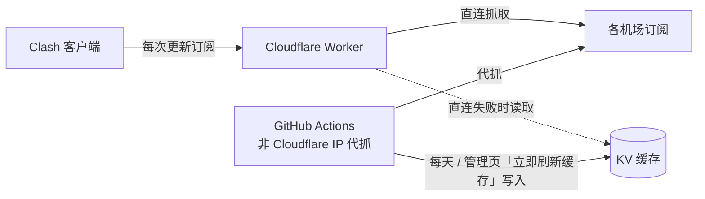

# MyClash 订阅合并

把多个机场订阅合并成**一个**订阅链接（节点并集），在客户端套用 [AIsouler/MyClash](https://github.com/AIsouler/MyClash) 覆写脚本。

- **一键合并**：Worker 地址就是管理页，粘贴多个机场订阅即生成合并链接，流量自动加总
- **即时节点**：客户端每次更新时即时抓各机场最新节点
- **不怕屏蔽**：机场屏蔽 Cloudflare（`HTTP 403`）时改用 GitHub Actions 代抓的缓存
- **倍率标注**：节点统一命名为 `飞云 | 2x | 香港 01`，1 倍不标
- **覆写脚本代理**：`/script.js` 跟上游同步，并让 HuggingFace 不走「AI」组
- **多种格式**：mihomo / Clash YAML，以及 base64 的 `ss` / `vmess` / `vless` / `trojan` / `hysteria2`



## 部署

**1. 部署 Worker**：[Cloudflare](https://dash.cloudflare.com/?to=/:account/workers-and-pages/create) → **导入存储库** → 选本仓库，
项目名称 `myclash`（须与 `wrangler.jsonc` 的 `name` 一致）、生产分支 `main`、部署命令 `npx wrangler deploy`，其余默认。
KV（`myclash-sub-store`）会自动创建。部署后打开 `https://myclash.<账号>.workers.dev` 就是管理页。

**2. 代抓缓存**（机场屏蔽 Cloudflare 时需要）：

1. Cloudflare [API 令牌](https://dash.cloudflare.com/profile/api-tokens) → 创建自定义令牌，权限 `账户 / Workers KV 存储 / 编辑`
2. 仓库 **Settings → Secrets → Actions** 新增 `CLOUDFLARE_API_TOKEN`
3. **Actions → 代抓订阅缓存 → Run workflow** 执行一次；之后每天自动执行，缓存保留 3 天

> 若提示「请在 Secrets 里直接指定」，再加 `CLOUDFLARE_ACCOUNT_ID` 与 `KV_NAMESPACE_ID`。日志不会印出订阅链接或节点。

**3. 管理页「立即刷新缓存」**（选做）：建 GitHub [Fine-grained token](https://github.com/settings/personal-access-tokens/new)
（只选本仓库，`Actions: Read and write`），在 Cloudflare 的 myclash → 设置 → 变量和机密，加**密钥** `GITHUB_TOKEN`。
fork 后请把 `wrangler.jsonc` 的 `vars.GITHUB_REPO` 改成自己的仓库。

## 使用

1. 管理页按「生成新的订阅」，粘贴各机场订阅（可批量粘贴），保存后「复制链接」或「一键导入 Clash」
2. 在 Clash Verge Rev / Mihomo Party / FlClash / Bettbox 等 mihomo 客户端加成**远程订阅**并开启自动更新
3. 添加**脚本覆写** `https://<Worker 地址>/script.js`（管理页可复制）
4. **关闭客户端的 DNS 覆写**（MyClash 脚本要求）

**覆写脚本**：`/script.js` 代理上游 [Script.js](https://raw.githubusercontent.com/AIsouler/MyClash/main/Script/Script.js)（缓存 1 小时），
并用 [bett-rules](https://github.com/appshubcc/bett-rules) 的 `huggingface` 规则集（与「AI」同源、每天更新）把 HuggingFace 分出来，
插在「AI」规则前、改走「默认代理」。只加工上游 `main()` 的输出，不依赖上游源码排版；AI 组没开时不做任何改动。

**节点前缀**：区分不同机场。

- **机场名称**（默认）：读订阅返回的文件名，读不到用域名，例如 `飞云 | 香港 01`
- **S1、S2…**：按顺序编号
- **不加前缀**：保留原名，同名自动加 `2`、`3`

可为单个机场填自定义前缀，但避免「香港、日本、美国、HK、US、JP、机场、订阅」等字样，以免干扰脚本的地区分组与节点过滤。

**倍率标注**（新建订阅默认勾选）：认得 `2x`、`2.0X`、`x2`、`×1.5`、`*3`、`2倍`、`2倍率`、`倍率:2`（可带括号），
去掉原字样后改写为 `前缀 | 2x | 原名`，例如 `美国04-1.5x |4837` → `MNKCloud | 1.5x | 美国04|4837`。
1 倍不标；「剩余流量 / 到期」等信息节点不处理。标注后仍会被脚本归入高/低倍率组。

## 注意事项

- **TOKEN 等同密码**：拿到链接的人能用节点，也能编辑或删除订阅。外流时按「换 TOKEN」，旧链接立即失效。
- **没有管理密码**：Worker 不提供列出所有订阅的功能；管理页清单只存在浏览器里，可用「导入 TOKEN」找回。
- **抓取失败**：失败且无缓存的机场会被跳过并在配置开头注释原因；全部失败时返回错误，客户端保留上次的配置。
- 合并结果**不含** `proxy-providers`（脚本会报错），保留各机场的 `dns` / `hosts`。
- 免费额度（Workers 每天 10 万次请求、KV 每天 1000 次写入）个人使用绰绰有余。

## 自动化

| 项目 | 时间 | 内容 |
| --- | --- | --- |
| 代抓订阅缓存 | 每天台湾时间 03:17，或管理页触发 | `.github/workflows/refresh-cache.yml` |
| 测试 | PR 与 `main` 有更新时（只改文档不跑） | 单元测试 + `wrangler deploy --dry-run` |
| 依赖更新 | 每月 1 号 | Dependabot 合成一个 PR，测试通过后自动合并 |
| 部署 | `main` 有更新时 | Cloudflare 自动重新部署 |

## 开发

```bash
npm install
npm test            # 单元测试
npx wrangler dev    # 本机运行（含本机 KV）
```

| 路径 | 说明 |
| --- | --- |
| `GET /sub/<TOKEN>` | 合并后的订阅（mihomo YAML） |
| `GET /script.js` | 修补后的 MyClash 覆写脚本 |
| `POST /api/subs` | 添加：`{ name, prefixMode: "name"\|"index"\|"none", rateTag: true, sources: [{ name, url }] }` |
| `POST /api/subs/lookup` | 一次查多个 TOKEN：`{ tokens: [...] }`（最多 50 个，查不到的不返回） |
| `GET` / `PUT` / `DELETE /api/subs/<TOKEN>` | 查找、编辑、删除 |
| `POST /api/subs/<TOKEN>/rotate` | 换新 TOKEN |
| `POST /api/subs/<TOKEN>/refresh` | 触发代抓缓存（需 `GITHUB_TOKEN`，1 分钟限一次） |

| 文件 | 说明 |
| --- | --- |
| `src/worker.js` | 路由、订阅输出、管理 API |
| `src/parse.js` | 订阅解析、倍率提取、合并、YAML 输出 |
| `src/script.js` | 覆写脚本修补 |
| `src/cache.js` | 代抓缓存的 KV 键名 |
| `scripts/refresh-cache.mjs` | GitHub Actions 代抓脚本 |
| `public/index.html` | 管理页 |

提交信息遵循 [Conventional Commits](https://www.conventionalcommits.org/zh-hans/v1.0.0/)。

## 致谢

- [AIsouler/MyClash](https://github.com/AIsouler/MyClash)：覆写脚本
- [Kwisma/cf-SubCloud](https://github.com/Kwisma/cf-SubCloud)：架构参考
