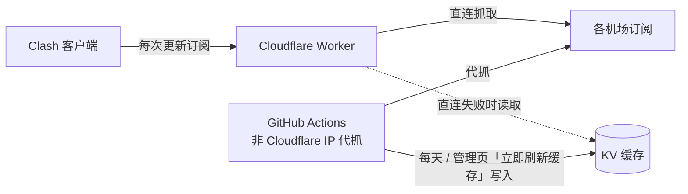

# MyClash 订阅合并

把多个机场订阅合并成**一个**订阅链接（节点并集），并直接套用 [AIsouler/MyClash](https://github.com/AIsouler/MyClash) 覆写脚本，客户端导入就能用。

- **一键合并**：Worker 地址就是管理页，粘贴多个机场订阅即生成合并链接，流量自动加总
- **即时节点**：客户端每次更新时即时抓各机场最新节点
- **不怕屏蔽**：机场屏蔽 Cloudflare（`HTTP 403`）时改用 GitHub Actions 代抓的缓存
- **到期屏蔽**：机场订阅到期或流量用完就自动跳过，流量与到期日也不计入；编辑页即时显示每个机场的到期日、流量与是否屏蔽
- **倍率标注**：节点统一命名为 `飞云 | 2x | 香港 01`，1 倍不标
- **服务端覆写**：同一个订阅可选精简 / 全量 / 不覆写三种链接，客户端不用再加脚本；分流组按服务测速，HuggingFace 不走「AI」组
- **自动导入**：订阅链接贴进浏览器网址栏、或按客户端的「首页」按钮，就会打开管理页并导入，换设备也能马上管理
- **多种格式**：mihomo / Clash YAML，以及 base64 的 `ss` / `vmess` / `vless` / `trojan` / `hysteria2`



## 部署

**1. 部署 Worker**：[Cloudflare](https://dash.cloudflare.com/?to=/:account/workers-and-pages/create) → **导入存储库** → 选本仓库，
项目名称 `myclash`（须与 `wrangler.jsonc` 的 `name` 一致）、生产分支 `main`、部署命令 `npx wrangler deploy`，其余默认。
KV（`myclash-sub-store`）会自动创建。部署后打开 `https://myclash.<账号>.workers.dev` 就是管理页。

**2. 代抓缓存**（机场屏蔽 Cloudflare 时需要）：

1. Cloudflare [API 令牌](https://dash.cloudflare.com/profile/api-tokens) → 创建自定义令牌，权限 `账户 / Workers KV 存储 / 编辑`
2. 仓库 **Settings → Secrets → Actions** 新增 `CLOUDFLARE_API_TOKEN`
3. **Actions → 代抓订阅缓存 → Run workflow** 执行一次；之后每天自动执行，缓存保留 3 天

> 若提示「请在 Secrets 里直接指定」，再加 `CLOUDFLARE_ACCOUNT_ID` 与 `KV_NAMESPACE_ID`。日志不会印出订阅链接或节点。

**3. 管理页「立即刷新缓存」「立即同步」**（选做）：建 GitHub [Fine-grained token](https://github.com/settings/personal-access-tokens/new)
（只选本仓库，`Actions: Read and write`），在 Cloudflare 的 myclash → 设置 → 变量和机密，加**密钥** `GITHUB_TOKEN`。
fork 后请把 `wrangler.jsonc` 的 `vars.GITHUB_REPO` 改成自己的仓库。

## 使用

1. 管理页按「生成新的订阅」，粘贴各机场订阅（可批量粘贴）并保存
2. 在订阅卡片选覆写脚本（精简 / 全量 / 小火箭 / 不覆写），按「复制链接」或「一键导入 Clash」（iPhone 小火箭见下方「iPhone：小火箭」）
3. 在 Clash Verge Rev / Mihomo Party / FlClash / Bettbox 等 mihomo 客户端加成**远程订阅**并开启自动更新（订阅卡片上的「首页」按钮会打开管理页并自动导入这个订阅）
4. **关闭客户端的 DNS 覆写**（MyClash 脚本要求）

**覆写脚本**：本仓库提供 [AIsouler/MyClash](https://github.com/AIsouler/MyClash)（MIT）两个版本的修改版，Worker 输出订阅时直接套用：

| 订阅链接 | 来源 | 说明 |
| --- | --- | --- |
| `/sub/<TOKEN>?script=lite` | 精简版 `Script.js` | 管理页默认，分流组：Google、AI、Apple、Telegram、Steam、AdBlock（Apple 从全量版搬来） |
| `/sub/<TOKEN>?script=full` | 全量版 `mihomoScript.js` | 另加 YouTube、Netflix、GitHub、Microsoft、TikTok 等 17 个分流组 |
| `/sub/<TOKEN>` | 不覆写 | 只合并节点；可自己在客户端加脚本覆写 `/script.js` 或 `/script-full.js` |
| `/sub/<TOKEN>` + `/shadowrocket.conf` | 小火箭（iPhone） | 管理页选「小火箭」：订阅只给节点，分流用 `public/shadowrocket.conf`，见下方「iPhone：小火箭」 |

> 用了 `?script=` 的链接，**客户端就不要再加脚本覆写**，否则会覆写两次。

相对原版的改动：
- 分流组用各自服务的测速网址，取自 [Bettbox](https://github.com/appshubcc/Bettbox) 的服务检测（如 AI → `https://api.anthropic.com/cdn-cgi/trace`、
  Telegram 改用 `https://api.telegram.org/`：Bettbox 的 `http://91.108.56.100/` 不支持 keep-alive，开了 unified-delay 测速常报错且延迟失准）；Bettbox 没检测的服务与地区、倍率组用通用测速网址 `https://connectivitycheck.gstatic.com/generate_204`（原版为 Apple 的测速网址），测速间隔从原版的 600 秒改为 300 秒。完整对照见 `scripts/sync-scripts.mjs` 的 `TEST_URLS`
- 用 [bett-rules](https://github.com/appshubcc/bett-rules) 的 `huggingface` 规则集把 HuggingFace 从「AI」组分出来，改走「默认代理」
- 「AI」组默认选「台湾」（原版为「美国」；订阅里没有台湾节点时由客户端退回第一项）
- 「台湾」地区组与「台湾-自动选择」改用 Claude 的测速网址 `https://api.anthropic.com/cdn-cgi/trace`（同「AI」组），按 Claude 的连通性挑节点
- 「AdBlock」组（默认 `REJECT`）加上 [LoopDns/Fuck-you-MIUI](https://github.com/LoopDns/Fuck-you-MIUI) 的 hosts 屏蔽清单（`MIhosts` + `Fhosts`，约 100 个域名：小米系统跟踪器、广告、安全中心云扫描、浏览器推送，以及内置的腾讯 / 字节 / 迅雷等 SDK）。
  同步时只取没注释掉的行，用 mihomo 转成 mrs 规则集 `public/rules/fuck-you-miui.mrs`（清单原文在同目录的 `.txt`），客户端跟其他规则集一样经 CDN 下载、每天更新，不必重新拉订阅。
  注意清单会挡掉 MIUI 的安装检查、系统应用更新（`update.miui.com`）、流量校正（`api.sec.miui.com`）、云扫描病毒等功能，不需要时可在 AdBlock 组改选 `PASS`（连同广告规则一起放行）
- 新增「IPv6」节点组：名称标有 IPv6 / v6、server 是 IPv6 地址或 `ip-version: ipv6` 的节点归进来（同时保留在原地区组），附「IPv6-自动选择」，图标为本仓库仿上游风格画的 `public/icons/IPv6.svg`（上游没有 IPv6 图标），并加进「默认代理」、各分流组与「漏网之鱼」；订阅里没有 IPv6 节点就不生成
- 省内存：日志级别 `info` → `warning`（info 会逐条记录连接）；本机 `xray` / `sing-box` 进程（如 v2rayN 的核心）最先直连，不经节点再代理一次。
  Sparkle 会把配置文件里的日志级别强制写成 `info`、启动后再按它自己的设置调整，用 Sparkle 时请在 Sparkle 里设日志级别

GitHub Actions 每天（UTC+8 04:00，也可在 Actions 页手动触发「同步上游覆写脚本」）执行 `node scripts/sync-scripts.mjs` 重新生成两个文件（同时更新 Fuck-you-MIUI 规则集；本机执行需要 [mihomo](https://github.com/MetaCubeX/mihomo)，或用 `MIHOMO` 环境变量指定路径），有变化且测试通过就直接提交到 `main`，服务端覆写在随后的部署中自动跟着更新；上游改版导致找不到修改位置时脚本会报错、流程失败且不提交，需要手动调整 `scripts/sync-scripts.mjs`。本机也可以直接执行同一个命令。
管理页「客户端怎么用」下方显示覆写脚本最后更新时间与最近一次同步结果（成功 / 失败 / 同步中，点时间可打开 GitHub 查看），设了 `GITHUB_TOKEN` 时还可按「立即同步」。

**节点前缀**：区分不同机场。

- **机场名称**（默认）：读订阅返回的文件名，读不到用域名，例如 `飞云 | 香港 01`
- **S1、S2…**：按顺序编号
- **不加前缀**：保留原名，同名自动加 `2`、`3`

可为单个机场填自定义前缀，但避免「香港、日本、美国、HK、US、JP、机场、订阅」等字样，以免干扰脚本的地区分组与节点过滤。

**倍率标注**（新建订阅默认勾选）：认得 `2x`、`2.0X`、`x2`、`×1.5`、`*3`、`2倍`、`2倍率`、`倍率:2`（可带括号），
去掉原字样后改写为 `前缀 | 2x | 原名`，例如 `美国04-1.5x |4837` → `MNKCloud | 1.5x | 美国04|4837`。
1 倍不标；「剩余流量 / 到期」等信息节点不处理。标注后仍会被脚本归入高/低倍率组。

## iPhone：小火箭

小火箭（Shadowrocket）读不了 mihomo 的 `.mrs` 规则集，也不执行覆写脚本，所以节点和分流分开导入：

- **节点**：`/sub/<TOKEN>`（不带 `?script=`）加为小火箭的订阅，Worker 照样合并机场、屏蔽到期的机场
- **分流**：`/shadowrocket.conf`（即 `public/shadowrocket.conf`），对标精简版：默认代理、自动选择、手动选择，香港 / 日本 / 美国 / 新加坡 / 台湾地区组（按节点名称归组，正则同精简版；同精简版分两层：「<地区>」可手选节点，默认选「<地区>-自动选择」测速挑最快的；
  手动点了节点就固定用它，重连 VPN 不会被测速结果改掉），
  Google、AI（默认台湾）、Apple、Telegram、Steam、AdBlock（默认 `REJECT`）与漏网之鱼，测速网址同精简版。
  规则集用 [blackmatrix7/ios_rule_script](https://github.com/blackmatrix7/ios_rule_script) 的 Shadowrocket `.list`（经 `cdn.jsdmirror.com`），
  与精简版的 bett-rules 不完全相同：没有 HuggingFace 分流与 Fuck-you-MIUI，国内只用 `DOMAIN-SUFFIX,cn` 与 `GEOIP,CN` 判断直连

这份配置手写，不跟上游同步；精简版的分流组有变化时要手动对照修改。

### 从头设置

1. 用非中国区的 Apple ID 在 App Store 购买安装 Shadowrocket
2. iPhone 的 Safari 打开管理页，导入你的订阅（粘贴 TOKEN 或订阅链接），订阅卡片的覆写脚本选「**小火箭**」
3. 按「**导入节点到小火箭**」，跳到小火箭后确认添加订阅。
   也可以手动添加：复制订阅链接，在小火箭首页按右上角「+」，类型选 `Subscribe`，URL 贴上订阅链接后保存
4. 回到管理页，按「**导入分流配置**」，跳到小火箭后在「配置」页点 `shadowrocket.conf` →「使用配置」。
   也可以手动添加：在「配置」页按右上角「+」，贴上 `https://<你的 Worker 地址>/shadowrocket.conf` 并下载，再点它 →「使用配置」
5. 首页的「全局路由」选「**配置**」，打开连接开关，第一次连接时允许添加 VPN 配置
6. 自动更新：
   - 先在系统「设置 → 通用 → 后台 App 刷新」允许 Shadowrocket（自动更新靠后台任务；重启手机或划掉 App 后要等下次打开才恢复）
   - 节点：小火箭「设置 → 自动更新 → 订阅」（小火箭把节点叫「服务器」，「更新服务器」就是更新节点订阅），间隔选 24 小时即可
   - 分流配置：「设置 → 自动更新 → 配置」打开「自动后台更新」，间隔选 1–7 天。配置里写了 `update-url`，会从 GitHub（经 CDN）取最新版，同时更新规则集；
     注意「更新配置」会用远程版本整份覆盖本机配置，**地区组、分流组的手选结果可能被重置**，介意的话间隔选长一点，或不开、需要时在「配置」页点它 →「更新配置」
   - 规则集：跟着配置更新

导入后如果首页没有节点，或某些节点连不上，可能是小火箭不支持该协议的写法。请回报机场的节点类型。

### 省电设置

**息屏断开、亮屏自动连上**：iOS 不允许 App 监听锁屏，快捷指令也没有「锁屏 / 解锁」触发条件。最接近的做法是用 iOS 自带的 VPN 按需连接：

1. 小火箭「设置 → 按需求连接」：打开，添加规则「Wi-Fi」与「蜂窝网络」，动作都选「连接」。
   **不要**打开「始终开启」：它让 VPN 任何时候都保持连接、断了就自动重连，跟息屏断开省电的目的相反
2. 打开「睡眠时断开」：设备睡眠时断开 VPN；亮屏后有 App 联网，iOS 会按上面的按需规则自动重新连上

限制：小火箭只能响应系统的睡眠指令，息屏后 iOS 不一定马上进入睡眠，有后台流量时也可能被唤醒重连。所以这不是「一锁屏就断」，只是尽量少连。
如果反而频繁断线，例如推送收不到，就关掉「睡眠时断开」。

**只在用某些 App 时开 VPN**：比按需连接更省电。在「快捷指令 → 自动化」新建「App」自动化，选要翻墙的 App（如 Claude、Telegram、X），勾选「已打开」并设为「立即运行」，动作选小火箭的「启动 Shadowrocket」。
再建一个选同一批 App、勾选「已关闭」的自动化，动作选「停止 Shadowrocket」。
用快捷指令控制时，就**不要**同时开按需求连接，两者会互相抢着开关。

**其他省电建议**：

- 全局路由用「配置」，不要用「代理」（全部走节点）
- 不装模块、不开 MitM / 脚本（HTTPS 解密很耗电）
- 配置里的自动测速间隔已设为 1800 秒（精简版为 300 秒），不要改小；首页也别开自动测延迟
- 系统「设置 → 电池」里，小火箭的后台耗电主要来自连接时长。用按需连接或快捷指令减少连接时间，比任何参数都有效

## 管理订阅

每个订阅卡片可以「编辑」（名称、机场、前缀、倍率标注）、「换 TOKEN」（旧链接立即失效）、「删除」（使用这个链接的客户端无法再更新）。

**到期屏蔽**：机场返回的 `subscription-userinfo` 标头里 `expire`（到期日）已过，或已用流量（`upload + download`）达到 `total` 的，合并时整个跳过，
不解析节点，流量与到期日也不计入合并后的订阅（否则客户端会把整个合并订阅显示成已到期）；续费或流量重置后下次更新就自动恢复。
直连失败时依代抓缓存里的资料判断。没有提供到期日或总流量（`total=0`）的机场不受影响。

打开「编辑」时会即时检查每个机场（只读响应标头，不下载节点），在每一列显示：

| 标签 | 说明 |
| --- | --- |
| 正常 | 到期日与剩余天数、已用 / 总流量 |
| 即将到期 | 7 天内到期（仍会合并） |
| 已屏蔽 | 已到期或流量用完，合并时自动跳过 |
| 缓存 | 直连失败，资料来自代抓缓存 |
| 失败 | 抓不到且没有缓存，合并时跳过 |

前缀栏会显示自动识别出的机场名称；新加或改过的链接要保存后才会检查。

管理页清单**只存在这个浏览器里**：Worker 没有管理密码，所以不提供列出所有订阅的功能。换设备、换浏览器或清除浏览器数据后清单会是空的，
但订阅仍然有效。只要手上还有订阅链接（客户端的订阅设置里都有），用以下任一方式就能找回来管理：

- 把订阅链接贴进浏览器网址栏打开
- 在客户端的订阅卡片按「首页」
- 贴到管理页清单下方的输入框

> 链接完全找不到时，到 Cloudflare → **存储和数据库 → Workers KV → `myclash-sub-store`**，`sub:` 开头的每一笔就是一个订阅（内容含名称与机场清单），直接删除即可。

## 注意事项

- **TOKEN 等同密码**：拿到链接的人能用节点，也能编辑或删除订阅。外流时按「换 TOKEN」，旧链接立即失效。
- **抓取失败**：失败且无缓存、已到期或流量用完的机场会被跳过并在配置开头注释原因
  （`# [名称] 失败：…`、`# [名称] 已屏蔽：订阅已于 2026-10-01 到期`、`# [名称] 已屏蔽：流量已用完（50.0 GB / 50.0 GB）`）；
  全部跳过时返回错误，客户端保留上次的配置。
- 合并结果**不含** `proxy-providers`（脚本会报错），保留各机场的 `dns` / `hosts`。
- 订阅内容由自带的精简 YAML 输出（`src/parse.js` 的 `dumpYaml`，节点一行一个）：比 js-yaml 快 4～6 倍，避免超过 Workers 免费方案每次请求 10 ms 的 CPU 时间。
- **免费额度**个人使用绰绰有余：

  | 项目 | 免费额度（每天） | 用量 |
  | --- | --- | --- |
  | Worker 请求 | 10 万次 | 客户端每次更新订阅算 1 次；打开编辑页检查到期日也算 1 次（管理页是静态文件，不计） |
  | KV 读取 | 10 万次 | 每次更新读 1 次；机场直连失败时每个机场再读 1 次缓存 |
  | KV 写入 | 1000 次 | 添加、编辑、换 TOKEN，以及代抓缓存（每个机场 1 次） |

  没人使用的旧订阅只占 KV 约 1 KB，不消耗请求。唯一可能超额的是链接外流被大量请求：超额后当天请求失败（台湾时间 08:00 重置，免费方案不会扣款），
  客户端保留上次的配置；按「换 TOKEN」即可止血。实际用量可在 Cloudflare → Workers → myclash → 指标查看。

## 自动化

| 项目 | 时间 | 内容 |
| --- | --- | --- |
| 代抓订阅缓存 | 每天台湾时间 03:17，或管理页触发 | `.github/workflows/refresh-cache.yml` |
| 测试 | PR 与 `main` 有更新时（只改文档不跑） | 单元测试 + `wrangler deploy --dry-run` |
| 依赖更新 | 每月 1 号 | Dependabot 合成一个 PR，测试通过后自动合并 |
| 部署 | `main` 有更新时 | Cloudflare 自动重新部署 |

## 开发

```bash
npm install
npm test            # 单元测试
npx wrangler dev    # 本机运行（含本机 KV）
```

| 路径 | 说明 |
| --- | --- |
| `GET /sub/<TOKEN>` | 合并后的订阅（mihomo YAML）；`?script=lite` / `?script=full` 在服务端套用覆写脚本；浏览器网址栏打开时跳到管理页 `/#import=<TOKEN>` 自动导入 |
| `GET /script.js`、`/script-full.js` | 修改版 MyClash 覆写脚本（精简 / 全量，静态文件） |
| `POST /api/subs` | 添加：`{ name, prefixMode: "name"\|"index"\|"none", rateTag: true, sources: [{ name, url }] }` |
| `POST /api/subs/lookup` | 一次查多个 TOKEN：`{ tokens: [...] }`（最多 50 个，查不到的不返回） |
| `GET` / `PUT` / `DELETE /api/subs/<TOKEN>` | 查找、编辑、删除 |
| `GET /api/subs/<TOKEN>/status` | 即时检查每个机场：`{ checkedAt, sources: [{ url, name, error, directError, cachedAt, info: { upload, download, total, expire }, blocked: null \| "expired" \| "exhausted" }] }` |
| `POST /api/subs/<TOKEN>/rotate` | 换新 TOKEN |
| `POST /api/subs/<TOKEN>/refresh` | 触发代抓缓存（需 `GITHUB_TOKEN`，1 分钟限一次） |
| `GET /api/scripts` | 覆写脚本同步状态：`{ run: { status, conclusion, event, createdAt, url } \| null, updated: { at, message, url } \| null, canTrigger }`（「同步上游覆写脚本」最近一次执行，与 `public/script.js` 最后一次改动的提交；在 KV 存 5 分钟） |
| `POST /api/subs/<TOKEN>/sync-scripts` | 触发「同步上游覆写脚本」（需 `GITHUB_TOKEN`，10 分钟限一次） |

| 文件 | 说明 |
| --- | --- |
| `src/worker.js` | 路由、订阅输出、管理 API |
| `src/parse.js` | 订阅解析、倍率提取、流量与到期日、合并、YAML 输出 |
| `src/cache.js` | 代抓缓存的 KV 键名 |
| `scripts/refresh-cache.mjs` | GitHub Actions 代抓脚本 |
| `public/index.html` | 管理页 |
| `public/script.js`、`public/script-full.js` | 修改版 MyClash 覆写脚本（由 `scripts/sync-scripts.mjs` 生成） |
| `public/rules/fuck-you-miui.mrs` | Fuck-you-MIUI 规则集（由 `scripts/sync-scripts.mjs` 生成，`.txt` 为域名清单） |
| `scripts/sync-scripts.mjs` | 从上游同步覆写脚本并套用改动 （`.github/workflows/sync-scripts.yml` 每天自动执行） |
| `scripts/build-overrides.mjs` | 部署 / 测试前把上面两个脚本包成 ES module（`src/overrides/`，不进 git），给服务端覆写用 |

提交信息遵循 [Conventional Commits](https://www.conventionalcommits.org/zh-hans/v1.0.0/)。

## 致谢

- [AIsouler/MyClash](https://github.com/AIsouler/MyClash)：覆写脚本
- [Kwisma/cf-SubCloud](https://github.com/Kwisma/cf-SubCloud)：架构参考
- [LoopDns/Fuck-you-MIUI](https://github.com/LoopDns/Fuck-you-MIUI)：MIUI 跟踪器屏蔽清单
